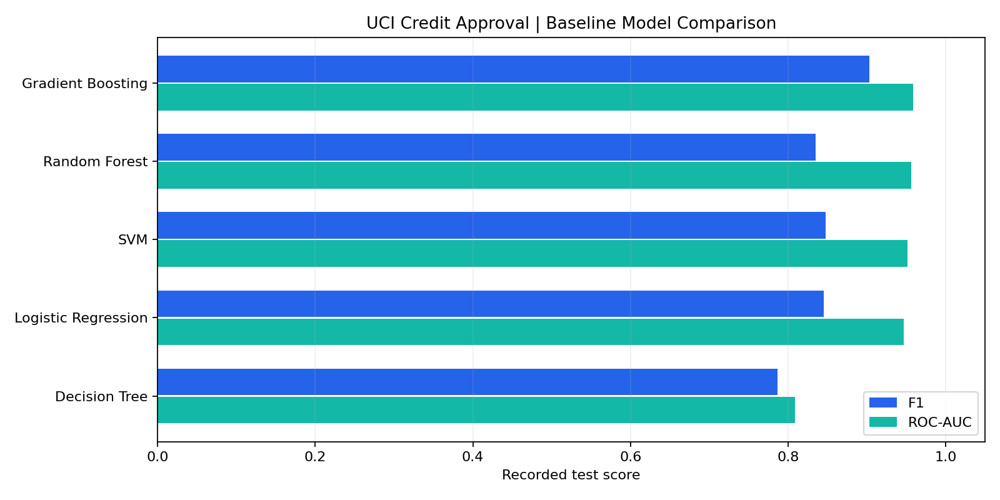
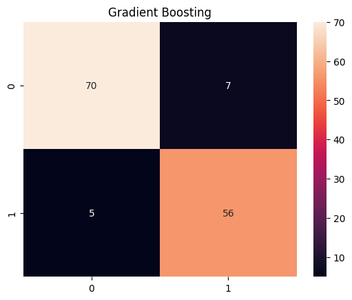
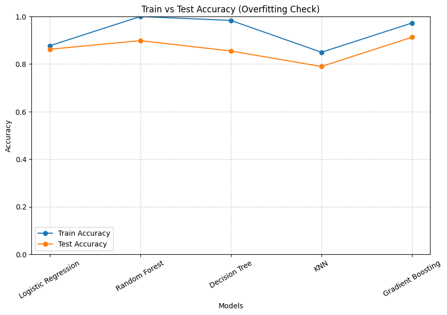

# Credit Approval Classification with Machine Learning

**A tabular machine learning project by Mehmet Mikail Karaman.**

I used the **UCI Credit Approval dataset** to build and compare classification models for historical credit application labels. The project covers mixed-type data preprocessing, stratified sampling, feature scaling, model comparison, Gradient Boosting hyperparameter search, cross-validation, and visual error analysis.

The highest ROC-AUC in the notebook's baseline comparison is **0.959123**, achieved by Gradient Boosting, with **91.30% test accuracy** and **0.903226 F1**. These are recorded experiment results; models were not retrained when preparing this repository.

## Dataset

[UCI Credit Approval](https://archive.ics.uci.edu/dataset/27/credit+approval), dataset ID **27**, contains 690 records and 15 mixed categorical/numeric features. UCI states that attribute names and values were anonymized to protect confidentiality. Features are therefore named **A1–A15**, without assigning invented business meanings.

| Property | Value in the recorded experiment |
| --- | --- |
| Records | 690 |
| Original features | 15 |
| Encoded features | 37 |
| Negative label (`-` → 0) | 383 |
| Positive label (`+` → 1) | 307 |
| Training subset | 552 records (80%) |
| Test subset | 138 records (20%) |
| Split configuration | Stratified; `random_state=42` |

Dataset attribution: J. R. Quinlan, *Credit Approval*, UCI Machine Learning Repository, [DOI: 10.24432/C5FS30](https://doi.org/10.24432/C5FS30). The notebook fetches the data using `fetch_ucirepo(id=27)`. Raw data is retrieved from UCI rather than bundled here.

## What I did

**Loaded and inspected the dataset.** Retrieved features and targets through `ucimlrepo`, standardized the target name to `class`, and inspected feature dimensions and class counts. **Handled missing values.** Replaced `?` markers with missing values, filled categorical columns with their mode, and filled numeric columns with their median.

**Encoded the inputs and target.** Applied `pd.get_dummies(..., drop_first=True)` to the features and mapped the target symbols to binary labels. **Created a stratified train/test split.** Held out 20% of the records while preserving class proportions.

**Standardized the features.** Fitted `StandardScaler` on training features and transformed test features with the fitted scaler. **Trained five baseline classifiers.** Compared Logistic Regression, Decision Tree, Random Forest, Gradient Boosting, and SVM with probability estimation.

**Tuned Gradient Boosting.** Used `GridSearchCV`, five-fold cross-validation, and F1 scoring to search 16 parameter combinations (80 fold fits, followed by refitting). **Evaluated model behavior.** Compared accuracy, precision, recall, F1, and ROC-AUC; plotted confusion matrices; and ran a separate train/test accuracy comparison including KNN.

**Generated exploratory profiling.** Used `ydata-profiling` to export a `credit_report.html` report from the raw UCI file. The supplied notebook records successful export; the HTML file itself was not supplied.

## Recorded baseline results

All rows below come from the saved notebook's 138-record test subset. Positive-class precision, recall, and F1 use label **1**. ROC-AUC uses positive-class probabilities.

| Model | Accuracy | Precision | Recall | F1 | ROC-AUC |
| --- | ---: | ---: | ---: | ---: | ---: |
| **Gradient Boosting** | **0.913043** | 0.888889 | **0.918033** | **0.903226** | **0.959123** |
| Random Forest | 0.862319 | 0.888889 | 0.786885 | 0.834783 | 0.956355 |
| SVM | 0.862319 | 0.828125 | 0.868852 | 0.848000 | 0.951458 |
| Logistic Regression | 0.862319 | 0.838710 | 0.852459 | 0.845528 | 0.946562 |
| Decision Tree | 0.811594 | 0.786885 | 0.786885 | 0.786885 | 0.809027 |



### Gradient Boosting confusion matrix

The following figure is extracted unchanged from the original baseline output. Rows are true labels and columns are predicted labels, ordered **0, 1**.



## Hyperparameter search and cross-validation

| Parameter | Searched values | Selected value |
| --- | --- | --- |
| `n_estimators` | 50, 100 | 100 |
| `learning_rate` | 0.01, 0.1 | 0.1 |
| `max_depth` | 3, 5 | 5 |
| `subsample` | 0.8, 1.0 | 1.0 |

The selected estimator uses `GradientBoostingClassifier(random_state=42)`. The subsequent five-fold F1 scores recorded in the notebook are:

```text
0.88659794, 0.86868687, 0.88235294, 0.80000000, 0.76923077
Mean F1: 0.8413737034476876
```

**The main test table evaluates the original baseline models, not the tuned estimator.** No tuned-model held-out test result is claimed. The cross-validation scores reuse the training data and hyperparameter-selection setting; they are not an independent nested cross-validation estimate.

## Training versus test accuracy

A separate experiment refits models, adds KNN, sets a Random Forest seed, and caps Decision Tree depth at 10. Its results should be read separately from the main comparison.

| Model | Training accuracy | Test accuracy |
| --- | ---: | ---: |
| Logistic Regression | 0.8768 | 0.8623 |
| Random Forest | 1.0000 | 0.8986 |
| Decision Tree | 0.9837 | 0.8551 |
| KNN | 0.8496 | 0.7899 |
| Gradient Boosting | 0.9728 | 0.9130 |



The tree-based models show higher training than test accuracy, making generalization an important focus for further experiments. The Random Forest result differs from the main table because it comes from a separate fit and configuration.

## Files and local use

| File | Purpose |
| --- | --- |
| `credit_approval_analysis.ipynb` | English notebook with explanatory sections and retained experiment outputs |
| `analysis.py` | Python export of the classification workflow; excludes optional HTML profiling |
| `recorded_results.csv` | Baseline scores transcribed from the saved comparison table |
| `model-comparison.png` | Chart generated from the recorded baseline scores |
| `gradient-boosting-confusion-matrix.png` | Original baseline confusion matrix |
| `train-test-accuracy.png` | Original generalization comparison figure |
| `requirements.txt` | Runtime dependencies |

```bash
python -m venv .venv
source .venv/bin/activate
pip install -r requirements.txt
jupyter lab credit_approval_analysis.ipynb
```

Alternatively, run `python analysis.py` to execute the exported classification workflow. Internet access is needed to retrieve the UCI dataset. HTML profiling runs in the notebook and writes `credit_report.html` locally.

## Evaluation and reproducibility notes

Preprocessing leakage: the original workflow imputes missing values and discovers one-hot categories before splitting the data. Imputation should instead be fitted within training folds using a pipeline before making stronger generalization claims. Scaling is fitted on the training subset, but is also performed outside the cross-validation folds. Run variability: several baseline estimators do not specify `random_state`. Their results can change between runs; the recorded table is not a guarantee of identical future scores.

Publication cleanup: the English notebook removes redundant/out-of-order cells, adds the missing `cross_val_score` import, and consistently uses the existing scaled arrays. A duplicated confusion-matrix loop with Turkish labels was omitted; the original English baseline figures remain. The algorithms and reported historical scores were not replaced with new experiments. Validation performed for this edition: Python code syntax, notebook structure, English text, result transcription, and local image links were checked. The full training and profiling workflow was not rerun. Dependency versions are mostly unpinned because a complete original environment lockfile was not supplied.

This repository presents an educational classification experiment on historical anonymized data; it has not been evaluated as a real lending decision system.

**Tools:** Python · pandas · NumPy · scikit-learn · Matplotlib · Seaborn · ucimlrepo · ydata-profiling
